<p align="center">
  <a href="https://jose-navarro.vanemisarts.com">
    
  </a>
</p>

<p align="center">
  <a href="https://jose-navarro.vanemisarts.com"></a>
  <a href="https://linkedin.com/in/josenavarro-dev"></a>
  <a href="mailto:josealena01@gmail.com"></a>
</p>

Ingeniero de Sistemas y programador backend con más de **4 años** construyendo software y con **ownership completo** de sistemas en producción: arquitectura, modelado de datos, seguridad y despliegue.

<sub>Systems Engineer and backend developer with 4+ years building software and full ownership of production systems. Remote from Venezuela (UTC-4).</sub>

### `~$ whoami`

```json
{
  "nombre": "José Alejandro Navarro Alfonzo",
  "alias": "joseale",
  "rol": "Senior Backend Developer",
  "ubicacion": "Venezuela · remoto · UTC-4",
  "core": ["Node.js", "TypeScript", "PostgreSQL"],
  "arquitectura": ["multi-tenant", "RLS", "serverless"],
  "devops": ["Docker", "GitHub Actions", "Nginx"],
  "ia": ["Claude", "Gemini", "agentes"],
  "status": 200
}
```

### Stack

<p>
  
  
  
  
  
  
  
  
  
  
  
</p>

### Ecosistema

| | Proyecto | |
|---|---|---|
| 🪐 | **[Vanemis Arts](https://vanemis.art)** | Agencia de marketing digital: contenido, redes y desarrollo web |
| 🌙 | **[Dubraska](https://dubraska.vanemis.art)** | Portafolio de community manager y editora de video |
| 🌙 | **[Ponkely](https://ponkely.vanemisarts.com)** | Menú público para pedir por WhatsApp + panel privado del negocio |
| 🌙 | **Cubix CRM** | CRM privado (demo en el portfolio con datos ficticios) |

<p align="center"><sub>Más detalle de cada proyecto en <a href="https://jose-navarro.vanemisarts.com/#ecosistema">jose-navarro.vanemisarts.com</a></sub></p>
